

  

  
  

  

  <a href="https://github.com/AdamFatnassi/CBR-RAG"></a>
  <a href="https://github.com/ranimmhiri/supportbot"></a>

  <a href="https://github.com/ranimmhiri/tunisia-night-lights-forecasting"></a>
  <a href="https://github.com/ranimmhiri/house-prices-kaggle"></a>

  

  

  

  
  

  
  

  

